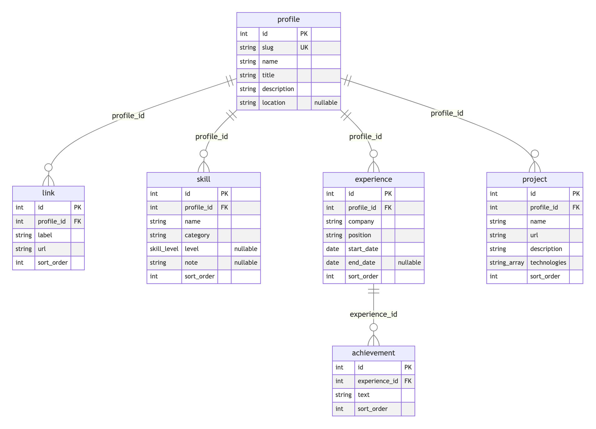
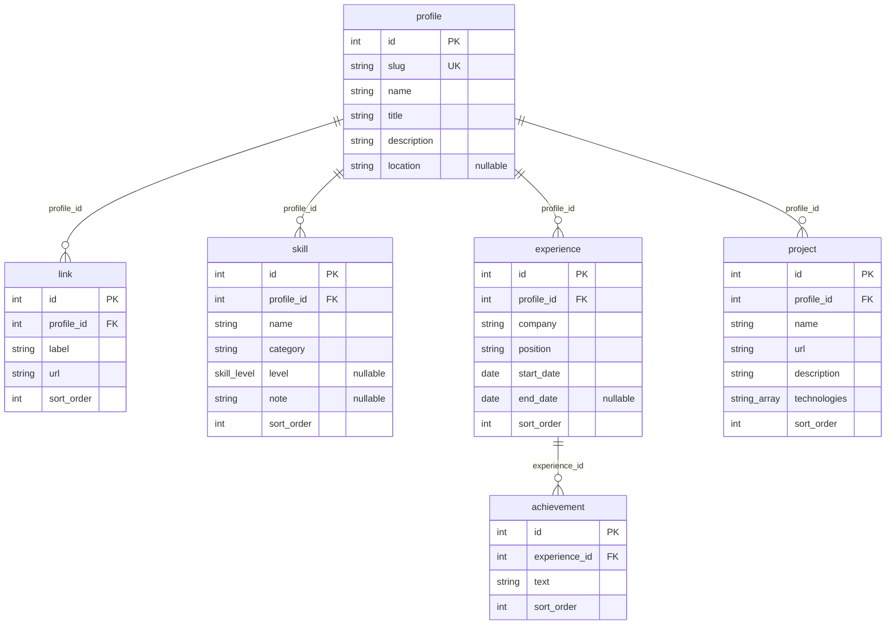

# Архитектура

> Здесь описана схема базы данных. Слои приложения, обработку запроса, решение проблемы N+1 и запуск см. в [README.md](README.md), разделы «Архитектура» и «Решения».

## ER-диаграмма

Одна «визитка» (`profile`) и связанные с ней данные. Два уровня вложенности: `profile → experience → achievement`. Внешние ключи имеют индексы (Postgres не создаёт их сам), `ON DELETE CASCADE` удаляет дочерние записи вместе с профилем.

Исходник диаграммы (Mermaid)

Схема описана в [`prisma/schema.prisma`](prisma/schema.prisma), миграции лежат в [`prisma/migrations`](prisma/migrations).
