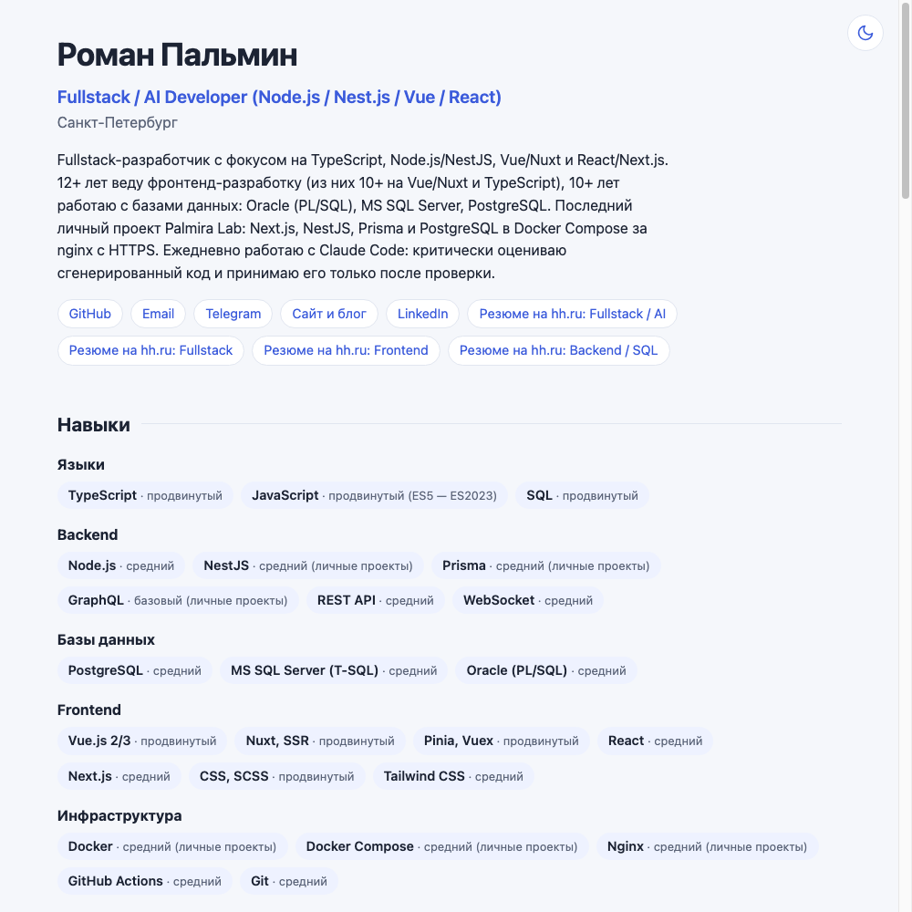
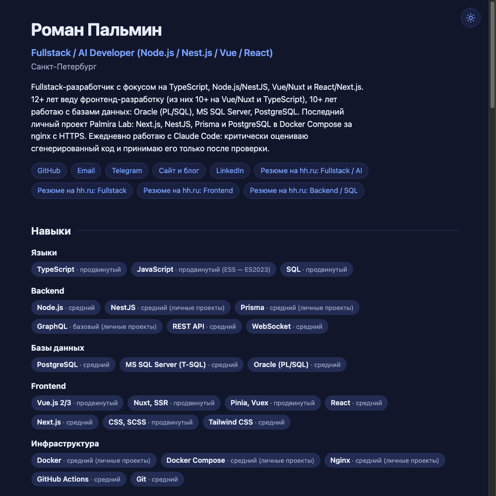
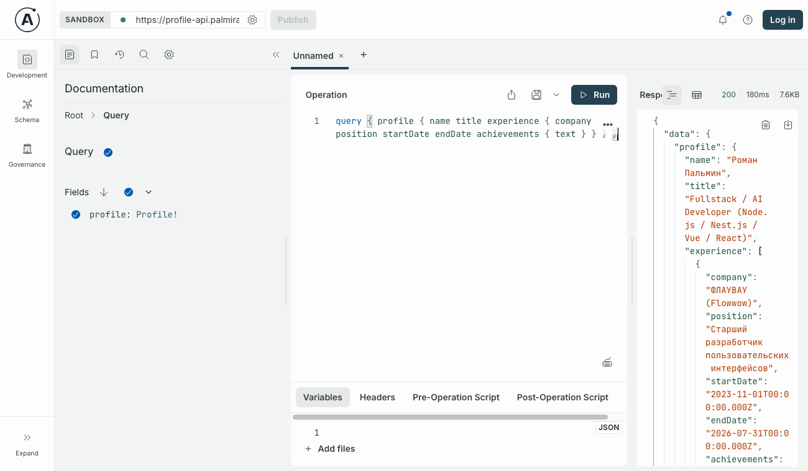
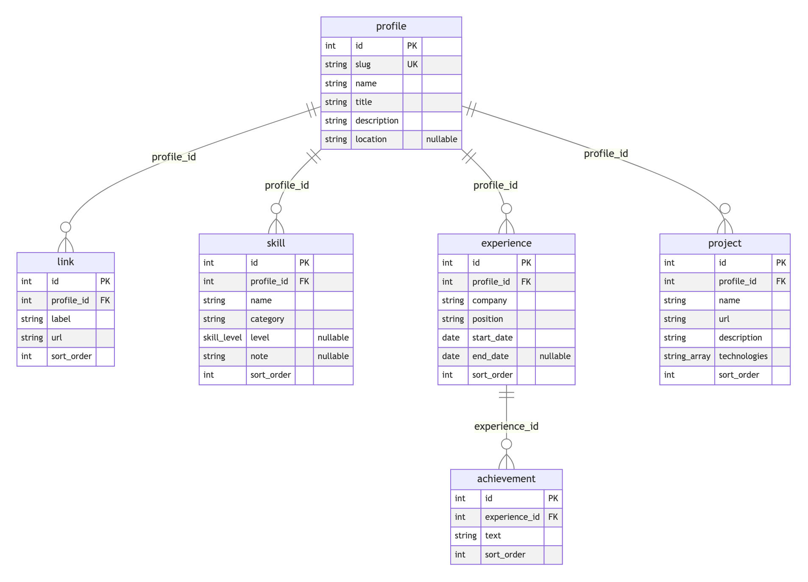

# profile-graphql-api

Цифровая визитка в виде backend-приложения: GraphQL API с профилем, ссылками, навыками, опытом работы (с достижениями) и проектами. Данные хранятся в PostgreSQL, база создаётся и заполняется автоматически при запуске. Через встроенный Apollo Sandbox можно выполнять запросы прямо в браузере.

**Стек:** TypeScript, Node.js, NestJS, GraphQL (Apollo, code-first), Prisma, PostgreSQL, Docker. Небольшой фронт на Vue 3 + Vite (папка `web/`) показывает те же данные.

**Стенд (работает в интернете):** визитка <https://profile-api.palmira-lab.online/>, Apollo Sandbox <https://profile-api.palmira-lab.online/graphql>.

## Как это выглядит

Визитка на Vue 3 (светлая и тёмная темы переключаются кнопкой, выбор запоминается):

<table>
  <tr>
    <td></td>
    <td></td>
  </tr>
</table>

Apollo Sandbox на стенде: вложенный запрос и реальный ответ API.



## Быстрый старт

Нужен только Docker (с Docker Compose).

```bash
git clone <адрес этого репозитория>
cd profile-graphql-api
docker compose up --build
```

Что произойдёт при первом запуске (шаги выполняются автоматически, подробности в `docker-entrypoint.sh`):

1. соберётся образ приложения и поднимется PostgreSQL;
2. применятся миграции (`prisma migrate deploy`);
3. база заполнится данными визитки (seed; повторный запуск не создаёт дублей);
4. запустится API.

Когда в логе появится `Nest application successfully started`, откройте **Apollo Sandbox**: <http://localhost:3000/graphql>

Остановить: `Ctrl+C`. Полностью удалить контейнеры и данные базы: `docker compose down -v`.

Фронт в `docker compose up` не входит: там только API и база. Запуск фронта описан в разделе «Локальная разработка», а на стенде его раздаёт nginx.

Если порты 3000 или 5432 заняты, задайте другие: `PORT=3001 DB_PORT=5433 docker compose up --build` (остальные переменные и значения по умолчанию в `.env.example`).

## Примеры запросов

Вставьте запрос в Apollo Sandbox и нажмите Run.

**1. Профиль с навыками, опытом и проектами:**

```graphql
query {
  profile {
    name
    description
    skills {
      name
    }
    experience {
      company
      position
    }
    projects {
      name
    }
  }
}
```

Фрагмент ответа:

```json
{
  "data": {
    "profile": {
      "name": "Роман Пальмин",
      "skills": [{ "name": "TypeScript" }, { "name": "JavaScript" }, { "name": "SQL" }],
      "experience": [
        { "company": "ФЛАУВАУ (Flowwow)", "position": "Старший разработчик пользовательских интерфейсов" },
        { "company": "ООО «Наука»", "position": "Ведущий разработчик" }
      ],
      "projects": [{ "name": "Palmira Lab" }, { "name": "kazan-test-task" }]
    }
  }
}
```

**2. Опыт работы с датами и достижениями (второй уровень вложенности):**

```graphql
query {
  profile {
    experience {
      company
      position
      startDate
      endDate
      achievements {
        text
      }
    }
  }
}
```

`endDate: null` означает «по настоящее время».

**3. Ссылки, навыки с уровнем и проекты с технологиями:**

```graphql
query {
  profile {
    title
    location
    links {
      label
      url
    }
    skills {
      name
      category
      level
      note
    }
    projects {
      name
      url
      description
      technologies
    }
  }
}
```

Все поля и их описания видны во вкладке Schema в Apollo Sandbox.

## Архитектура

### Структура проекта

```
src/
├── main.ts                      запуск приложения
├── app.module.ts                корневой модуль, настройка GraphQL (Apollo, контекст с лоадерами)
├── prisma/
│   ├── prisma.module.ts         модуль доступа к базе (экспортирует PrismaService)
│   └── prisma.service.ts        клиент Prisma: подключение, закрытие, подписка на SQL-запросы
├── profile/
│   ├── models/                  GraphQL-типы (Profile, Link, Skill, Experience, Achievement, Project)
│   ├── profile.resolver.ts      запрос profile и вложенные поля (ссылки, навыки, опыт, проекты)
│   ├── experience.resolver.ts   вложенное поле второго уровня: достижения
│   ├── profile.service.ts       запросы к базе (Prisma), без знания о GraphQL
│   ├── loaders/                 DataLoader для достижений и контекст GraphQL
│   └── profile.module.ts
├── seed/                        данные визитки и идемпотентное заполнение базы
└── generated/                   клиент Prisma (создаётся командой prisma generate, в git не хранится)
prisma/
├── schema.prisma                схема базы данных
└── migrations/                  миграции (применяются при старте контейнера)
web/                             фронт на Vue 3 + Vite + TypeScript (отдельный пакет)
├── src/api.ts                   fetchProfile(): один запрос на /graphql, разбор ошибок
├── src/format.ts                чистые функции: период работы («по н.в.»), уровень, группировка навыков
├── src/components/              ProfileCard, AppLoader, ThemeToggle
└── src/theme.ts                 светлая и тёмная тема, выбор запоминается
```

### Слои

Каждый слой отвечает за своё и ничего не знает о слоях выше.

| Слой | Где | Отвечает за | Не знает о |
|---|---|---|---|
| API (resolver) | `*.resolver.ts` | разбор GraphQL-запроса, вызов сервиса, форма ответа | SQL, Prisma |
| Сервис | `profile.service.ts` | получение данных: запросы к базе | GraphQL, HTTP |
| Модели | `models/` | описание типов GraphQL-схемы | где хранятся данные |
| Доступ к базе | `PrismaService` | подключение и запросы к PostgreSQL | бизнес-смыслу данных |

Резолвер только делегирует сервису и берёт идентификатор родителя из `@Parent()`, поэтому его можно проверять unit-тестом без базы (`profile.resolver.spec.ts`).

### Как выполняется запрос

Запрос `{ profile { experience { company achievements { text } } } }`:

```
клиент ──► GraphQL (Apollo) ──► ProfileResolver.profile()         ──► ProfileService ──► SQL: profile       (1 запрос)
                            └─► ProfileResolver.experience()      ──► ProfileService ──► SQL: experience    (1 запрос)
                            └─► ExperienceResolver.achievements() × 12 мест работы
                                       │ loader.load(id) копит id в течение одного тика
                                       └─► ProfileService ──► SQL: achievement WHERE experience_id IN (...)  (1 запрос на все места)
```

Всего три SQL-запроса независимо от числа мест работы. Подробности решения (DataLoader, контекст на запрос) в разделе «Решения».

### База данных

Схема из шести таблиц: `profile`, `link`, `skill`, `experience`, `achievement`, `project`; два уровня вложенности `profile → experience → achievement`. Подробное описание: [ARCHITECTURE.md](ARCHITECTURE.md).



Исходник диаграммы (Mermaid): `diagrams/er-diagram.mmd`.

## Решения

Для каждого решения: что выбрано, почему, какие альтернативы отброшены, как это проверить.

### 1. Code-first GraphQL

- **Решение.** Схема строится из TypeScript-классов и декораторов (`@ObjectType`, `@Field`, `@Resolver`), а не пишется вручную в SDL.
- **Почему.** Один источник правды: тип поля описан один раз в коде, и компилятор проверяет его вместе с остальным приложением. Не нужно держать в синхронизации SDL-файл и классы.
- **Альтернативы.** Schema-first (SDL отдельно): удобнее обсуждать контракт с другими командами, но схему и резолверы приходится сопоставлять вручную, а несоответствие вылезает только при запуске.
- **Проверка.** Схема собирается при старте приложения; Sandbox показывает типы и описания полей (во вкладке Schema).

### 2. Слои: resolver → service → Prisma

- **Решение.** Резолвер разбирает запрос и вызывает сервис; сервис ходит в базу через `PrismaService`; модели описывают типы схемы. Отдельный слой «репозиториев» поверх Prisma не вводился.
- **Почему.** Резолвер остаётся тонким и проверяется без базы (заглушка сервиса); способ получения данных можно менять (например, добавить пакетную загрузку), не трогая API. Prisma Client уже даёт типизированный доступ к данным, поэтому ещё один слой над ним добавил бы код без выгоды при таком небольшом сервисе.
- **Альтернативы.** Запросы к базе прямо в резолвере (быстрее написать, но нельзя проверить unit-тестом без базы); отдельный репозиторий (оправдан при нескольких источниках данных или сложных запросах).
- **Проверка.** `profile.resolver.spec.ts`: резолвер проверяется с заглушкой сервиса, без базы.

### 3. N+1: DataLoader в контексте GraphQL

- **Проблема.** GraphQL вызывает резолвер вложенного поля для каждого родителя отдельно. Для запроса «профиль → места работы → достижения» при 12 местах работы получалось **14 SQL-запросов** (1 + 1 + 12).
- **Решение.** Поле `achievements` загружается через DataLoader: резолверы 12 мест просят достижения «по одному», лоадер собирает id за один тик цикла событий и делает **один** запрос `WHERE experience_id IN (...)`, затем раскладывает строки по местам. Итого **3 запроса** независимо от числа мест. Лоадеры создаются в `context` GraphQL на каждый запрос.
- **Почему.** Поле грузится только если клиент его запросил (запрос без `achievements` не обращается к таблице вообще), слои остаются разделёнными (сервис не знает, что запросил клиент), решение работает на любой глубине вложенности.
- **Альтернативы.** `include` в корневом запросе: тоже один пакетный запрос, но выполняется всегда, даже когда достижения не нужны. Лоадер как провайдер с областью `REQUEST`: работает, но область запроса «поднимается» по цепочке зависимостей и пересоздаёт резолверы на каждый запрос. Один лоадер на всё приложение: отброшен, его кэш жил бы вечно (устаревшие данные, рост памяти, утечка данных между пользователями).
- **Проверка.** E2E-тесты в `test/graphql.e2e-spec.ts` считают реальные SQL-запросы через событие Prisma: ровно 3 запроса на вложенный запрос, ноль обращений к `achievement` без поля `achievements`, повторный запрос снова идёт в базу (лоадер на запрос). Тест на соответствие сверяет достижения каждого места с базой. Лог всех запросов: переменная `PRISMA_LOG_QUERIES=true`.

### 4. Prisma и PostgreSQL, миграции в репозитории

- **Решение.** Схема описана в `prisma/schema.prisma`, миграции лежат в `prisma/migrations` и применяются командой `prisma migrate deploy` при старте контейнера.
- **Почему.** Из одной схемы получаются и таблицы (миграция), и TypeScript-типы; состояние базы воспроизводимо на любой машине. `migrate deploy` только применяет готовые миграции, не создаёт новых и не сбрасывает данные, поэтому безопасен в контейнере.
- **Альтернативы.** `migrate dev` (для разработки: создаёт миграции, может сбросить базу); `synchronize` в ORM (меняет схему «по месту», без истории); TypeORM или ручной SQL.
- **Проверка.** Запуск на пустой базе (`docker compose up --build`) создаёт таблицы и данные с нуля.

### 5. Идемпотентный seed

- **Решение.** Данные визитки лежат в `src/seed/seed-data.ts` (версионируются в git). Заполнение: профиль `upsert` по `slug`, дочерние записи удаляются и создаются заново, всё в одной транзакции.
- **Почему.** Контейнер может перезапускаться (сбой, `restart`, повторный `docker compose up`); повторный запуск не должен создавать дубли, а сбой посередине не должен оставлять базу наполовину заполненной.
- **Альтернативы.** Простой `INSERT` (дубли при повторном запуске); заполнение только на пустой базе (не обновляет данные при их изменении).
- **Проверка.** Перезапуск контейнера: число записей не меняется (12 мест работы до и после).

### 6. Запуск с нуля одной командой

- **Решение.** `docker compose up --build` поднимает PostgreSQL и API; точка входа `docker-entrypoint.sh` выполняет миграции, seed и запуск приложения (`set -e`: при ошибке контейнер останавливается, `exec`: приложение получает сигналы остановки). Клиент Prisma не хранится в git и генерируется внутри образа (`prisma generate`).
- **Почему.** Проверяющему не нужны ни Node.js, ни PostgreSQL на машине; нет шагов, которые легко забыть. Сборка не зависит от файлов, лежащих только на диске разработчика (`src/generated` исключён из контекста сборки).
- **Альтернативы.** Отдельные команды миграции и seed вручную (легко пропустить); хранить сгенерированный клиент в git (шум в диффах и риск расхождения со схемой).
- **Проверка.** Чистый `git clone` и `docker compose up --build` на пустой базе: миграция применилась, seed отработал, запрос из задания отдаёт данные, Sandbox открывается.

### 7. Apollo Sandbox в том числе в production

- **Решение.** Sandbox доступен на `/graphql` всегда, интроспекция включена; плагин страницы указан явно.
- **Почему.** Это публичная визитка с данными только для чтения, секретов в схеме нет; без явного плагина Apollo в production показывает пустую страницу вместо Sandbox.
- **Альтернативы.** Отключить в production (для закрытого API разумно; здесь противоречило бы цели «показать API в браузере»).
- **Проверка.** `GET /graphql` из браузера открывает Sandbox (есть e2e-тест).

### 8. Небольшой фронт на Vue 3 в том же репозитории

- **Решение.** Фронт лежит в `web/` как отдельный пакет (Vue 3, Vite, TypeScript): один `fetch` на `/graphql`, без роутера, хранилища и Apollo Client.
- **Почему.** Задача про backend, фронт нужен, чтобы увидеть данные глазами и убедиться, что API удобен клиенту. Один запрос с вложенными полями показывает, что N+1 решён на сервере, а не обходится на клиенте. Запрос идёт на относительный адрес `/graphql`: фронт и API на одном домене (nginx), поэтому CORS настраивать не нужно; в разработке Vite сам проксирует `/graphql` на API. Логика вынесена в чистые функции (`format.ts`) и покрыта тестами, а `endDate: null` превращается в «по н.в.» на клиенте.
- **Альтернативы.** Apollo Client или urql (для одного запроса лишняя зависимость); Nuxt и SSR (визитке не нужны); отдельный репозиторий и домен (потребовали бы CORS и отдельного деплоя).
- **Проверка.** 22 теста (Vitest, happy-dom), сборка с проверкой типов (`vue-tsc`), тесты проверены мутациями; на стенде открыто в браузере.

## Локальная разработка

Нужны Node.js 24 и Docker (для базы).

```bash
cp .env.example .env          # при занятом порту 5432 поменяйте DB_PORT и порт в DATABASE_URL
docker compose up -d db       # только база данных
npm ci
npm run prisma:generate       # создаёт клиент Prisma в src/generated (в git его нет, без этого шага не работают ни приложение, ни тесты)
npm run prisma:deploy         # применяет миграции
npm run seed                  # заполняет базу
npm run start:dev             # приложение на http://localhost:3000/graphql, с перезапуском при изменениях
```

### Фронт (папка `web/`)

API должен быть запущен (см. выше). В другом терминале:

```bash
cd web
npm install
npm run dev       # http://localhost:5173, запросы /graphql идут на localhost:3000
npm test          # тесты фронта
npm run build     # сборка в web/dist (типы проверяются)
```

Если API стоит на другом адресе: `API_URL=http://localhost:3001 npm run dev`.

Полезные команды:

| Команда | Что делает |
|---|---|
| `npm run lint` | проверка кода (oxlint) |
| `npm run format` | форматирование (prettier) |
| `npm run prisma:migrate` | создать новую миграцию после правки `schema.prisma` (только для разработки) |
| `PRISMA_LOG_QUERIES=true npm run start:dev` | печатать каждый SQL-запрос в консоль |

## Тесты

```bash
npm test            # unit-тесты, база не нужна
npm run test:e2e    # e2e-тесты: нужна запущенная и заполненная база (см. выше)
```

- **Unit** (`src/**/*.spec.ts`): резолвер с заглушкой сервиса (он только делегирует и берёт `id` родителя); целостность данных seed.
- **E2E** (`test/graphql.e2e-spec.ts`): настоящее приложение и база. Запрос из условия задания; достижения попадают к своим местам работы в нужном порядке (сверка с базой); число SQL-запросов (3 на вложенный запрос, ноль к `achievement`, если поле не запрошено); повторный запрос снова идёт в базу (лоадер живёт один запрос); Sandbox отдаётся браузеру.
- **Фронт** (`web/`, `npm test` внутри папки): 22 теста. Функции форматирования (период с «по н.в.», уровни, группировка навыков), `fetchProfile` с подменённым `fetch` (успех, HTTP-ошибка, ответ не в JSON, `errors` при HTTP 200, `profile: null`, недоступная сеть, отмена запроса), компоненты карточки профиля и экрана загрузки. Тесты фронта проверялись мутациями так же, как тесты бэкенда (сломанные «по н.в.», чтение дат в местном времени вместо UTC, пропуск проверки `errors`, лишний `target` у ссылок), и каждая поломка роняла хотя бы один тест.
- **Проверка самих тестов мутациями.** Тесты на N+1 проверялись так: код специально ломался (лоадер делает запрос на каждый id, лоадер без пакетирования, достижения грузятся всегда, один лоадер на всё приложение, перепутан порядок результатов), и каждый раз хотя бы один тест падал. Одна из поломок («один лоадер на всё приложение») сначала ловилась только случайно, поэтому добавлен отдельный тест на неё.

## Что можно улучшить

- **CI.** Прогон lint, unit и e2e на каждый push (GitHub Actions).
- **Защита публичного API.** Ограничение глубины и сложности GraphQL-запросов; сейчас API открытое и только для чтения (на стенде частоту запросов ограничивает nginx, в самом приложении ограничения нет).
- **Healthcheck приложения** в `docker-compose.yml` (сейчас он есть только у базы).
- **Фронт в Docker.** Сборка статики отдельной стадией и раздача nginx внутри Compose, чтобы `docker compose up` поднимал и визитку; сейчас фронт собирается и выкладывается отдельно.
- **Изменяемость данных.** Сейчас визитка меняется правкой `seed-data.ts` и перезапуском; можно добавить мутации с авторизацией.
- **Seed.** При каждом перезапуске дочерние записи пересоздаются (идентификаторы меняются); при появлении внешних ссылок на них потребуется обновление «по месту».
- **Единственный профиль.** Запрос `profile` без аргументов возвращает первый профиль; модель допускает несколько (поле `slug`), можно добавить `profile(slug: ...)`.
